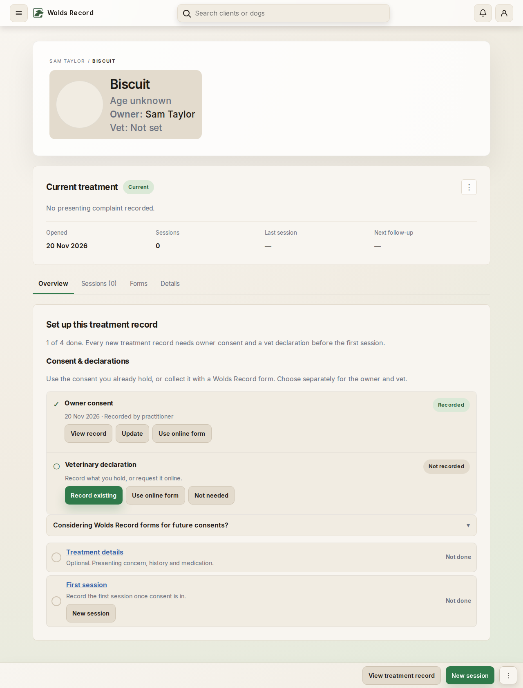

# Create and manage clients and dogs

## Create a client

From **Clients**:

1. Select **New client**.
2. Enter:
   - **Client name** (required)
   - Email (optional)
   - Phone (optional)
   - Address (optional)
3. Select **Create client**.

## Add a dog to a client

From the client record:

1. Select **Add dog**.
2. Enter the **Dog name** (required). Sex, age, ownership duration and neutered
   status are optional and can be left as unknown.
3. Optionally set breed and vet practice.
4. Select **Create dog**.

## Vet practice assignment during dog setup

When adding a dog, you can:

- Select an existing vet practice, or
- Create a new practice inline and assign it immediately.

## Dog record

A dog's record is the hub for the dog's current treatment record. It has four
tabs:

- **Overview**: the setup checklist while the treatment record is being set
  up. Once setup is complete, it shows recent sessions and the consent status.
- **Sessions**: the sessions in the current treatment record.
- **Forms**: owner consent and the veterinary declaration, with completed
  forms, and the practice information and terms shown to the owner.
- **Details**: treatment details, external resources, the dog summary and
  previous treatment records.

### Set up a treatment record

Until a new treatment record is set up, the **Overview** tab shows **Set up
this treatment record**. Every new treatment record needs owner consent and a
vet declaration before the first session. The steps are:

1. Owner consent
2. Veterinary declaration
3. Treatment details (optional)
4. First session

Each step links to where you complete it. When every step is done, the
checklist is replaced by **Setup complete**.

### Record consent you already hold

If you received owner consent or a vet declaration outside Wolds Record, for
example on a signed paper form, record it on the treatment record:

1. Open the dog's record.
2. On the **Overview** or **Forms** tab, find **Owner consent** or
   **Veterinary declaration** and select **Record existing**.
3. Enter the **Date received** and, optionally, **Notes**.
4. Select **Save consent** or **Save declaration**.

To change a recorded entry, select **Update**. If it was recorded in error,
select **Clear manual entry** or **Clear recorded status**. Its history is
kept.

If a vet declaration is not needed, select **Not needed** and record your
reason.

### Collect consent with an online form

Wolds Record does not send form links. You copy the link and send it yourself.

1. Open the dog's record.
2. On the **Overview** or **Forms** tab, select **Use online form** next to
   **Owner consent** or **Veterinary declaration**.
3. A locked preview shows the form as the owner or vet practice will see it.
   Check it, then select **Create link**.
4. Select **Copy link** and send it to the owner or vet practice.

To stop a link working, select **Deactivate link**. Recorded consent and
completed online forms stay on file.

### View a completed form

When an owner or vet practice has completed an online form, select **View
completed form** next to it. The vet declaration shows the wording as it was
signed.

## Edit a dog

1. Open the dog's record.
2. On the **Details** tab, open the actions menu on the **Dog summary** card
   and select **Edit Dog**.
3. Update the details. Only **Dog name** is required. **Sex** and
   **Neutered** can be set to **Unknown**, and age can be left blank.
4. Select **Save changes**.
